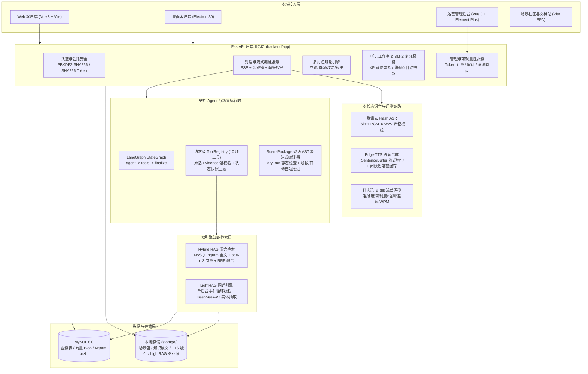
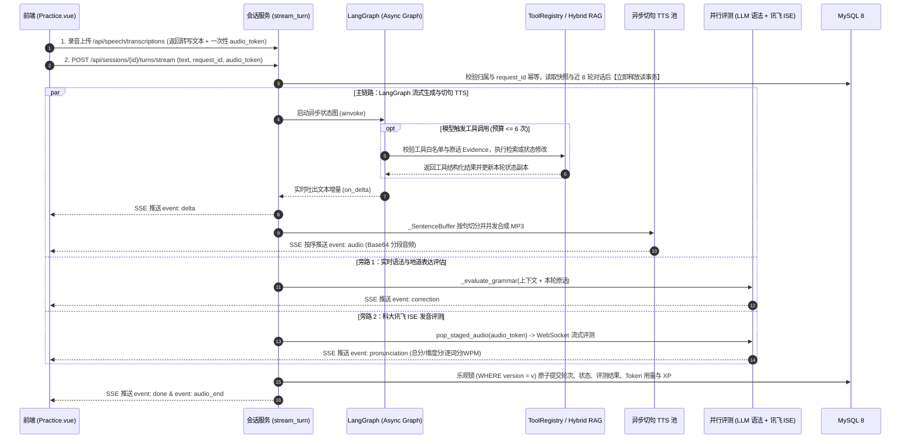

# EchoTalk 2.0 — 全栈 AI 英语听说与多智能体实训平台


**EchoTalk 2.0** 是一个面向真实语境的 **AI 英语听说实训与自适应学习平台**（支持 Web 端、Electron 桌面客户端与独立 Admin 运营后台）。

项目围绕 **“学 — 练 — 测 — 评 — 复习”** 完整闭环构建：底层基于 **FastAPI + LangChain / LangGraph** 实现受控状态机对话 Agent，结合 **声明式场景包（`ScenePackage v2`）与 AST 安全表达式引擎** 驱动多阶段任务流转；知识层融合 **Hybrid RAG（MySQL `ngram` 全文 + `bge-m3` 向量 + RRF 重排）** 与 **LightRAG 实体关系图谱**；多模态交互层打通 **WebAudio 本地采样、腾讯云 Flash ASR、SSE 流式分句并发 TTS、科大讯飞 ISE 流式口语评测与程序化 2D 数字人实时口型驱动**，并配套 **多角色辩论工作台、听力/四六级工作室、SM-2 间隔重复复习与 Token 成本监控后台**。

---

## 一、 核心功能全景

| 模块 | 核心能力与业务闭环 |
| :--- | :--- |
| **🎙️ 场景语音对话 (`Practice`)** | 基于 `ScenePackage v2` 声明式场景包（机场改签、咖啡点单、产品发布会对齐、技术面试、火车购票等），支持 **SSE 流式回复 + 增量切句并发 TTS 播报**、浏览器 `AudioWorklet` 录音与 ASR 转写确认、场景知识自动检索、划词 AI 语境解析、实时目标/阶段推进。 |
| **📊 课后多维报告与发音评测** | 对话期间后台并行执行 **LLM 语法与地道表达纠错** 及 **科大讯飞 ISE 流式语音评测**（准确度、流利度、完整度、语调韵律、连读自然度、WPM 语速与逐词打分），会话结束生成多维雷达报告与针对性改进建议。 |
| **⚖️ 多角色辩论工作台 (`Debate`)** | 覆盖**开篇立论 → 交叉质询 → 焦点攻防 → 总结裁决**四阶段；支持正反方立场选择、自定义辩题与知识库挂载、AI 对手辩手与 AI 裁判协同推演、五维能力评分（论点、反驳、证据、表达、策略）及金句复盘。 |
| **🎧 听力与四六级工作室 (`Listening`)** | 涵盖日常精听、英语电台、TED 风格演讲及 **CET-4 / CET-6 真题专项**；内置词块拼句（Word Bank）、听音选择、听写填空（Cloze）与跟读模仿（Shadowing）四种交互题型，支持错因标签统计。 |
| **🧠 双引擎知识工作区 (`Knowledge`)** | 支持场景级与个人级资料库（Markdown / TXT / PDF 解析分块、可见性隔离 `user` / `ai_only`）；同时提供 **Hybrid RAG 混合检索** 与 **LightRAG 知识图谱检索**，前端内置可缩放/拖拽的力导向实体关系图与索引进度透传。 |
| **🔁 SM-2 间隔重复复习 (`Review`)** | 自动扫描历史对话中的**语法纠错、发音低分词（< 78 分）与 Agent 标记的复习任务**，幂等生成复习卡片；基于 **SM-2 算法**（Again / Hard / Good / Easy 四档动态调节 `ease_factor` 与复习间隔）驱动每日记忆强化。 |
| **🧑‍🎨 程序化 2D 数字人 (`Avatar`)** | 内置多套角色形象与音色预设，支持按场景独立绑定数字人偏好與语速；利用 Web Audio API `AnalyserNode` 实时计算音频 RMS 包络驱动数字人**口型同步（Lip-sync）与眨眼/呼吸动效**。 |
| **🛠️ 运营管理后台 (`Admin`)** | 基于 Vue 3 + Element Plus 的独立管理端，提供全局业务看板、用户与管理员权限管理、场景包与听力题库上下架、数字人预设配置、对话会话轨迹审计以及 **LLM Token 多维消耗统计**。 |

---

## 二、 系统架构与核心执行流

### 2.1 整体架构图



### 2.2 单轮 SSE 流式对话与并行评测时序



---

## 三、 核心工程亮点（Engineering Highlights）

### 1. 声明式场景包（`ScenePackage v2`）与 AST 白名单表达式引擎
* **痛点**：传统硬编码 Prompt 难以维护多阶段任务（如“先核对航班号 → 再选择改签舱位 → 最后确认差价”），而直接使用 Python `eval()` 执行配置表达式存在严重的代码注入隐患。
* **实现**：在 [`backend/app/scenes/schema.py`](backend/app/scenes/schema.py) 与 [`backend/app/core/expr.py`](backend/app/core/expr.py) 中设计了完整的 `scene.yaml` 声明模型，并基于 Python `ast` 模块手写了**白名单条件编译器**：
  * 仅放行布尔逻辑、比较运算、`state.<path>` 属性/下标引用及 `tool_called()`、`state_changed()`、`goals_done()` 三个内置谓词函数；
  * 在场景创建、编辑和 `.zip` 导入阶段执行静态 `dry_run()` 校验，提前拦截未声明的状态键或非法语法；
  * 每轮工具执行后由程序确定性求值 `objectives.check`、`stages.exit_when` 与 `finish.when`，实现**“模型负责自然语言交互与工具决策，程序负责确定性状态流转与过关判定”**。

### 2. 受控 Agent 循环、原话证据强校验（Evidence Grounding）与 XML 容错
* **防状态幻觉**：在 [`backend/app/agents/tools.py`](backend/app/agents/tools.py) 中，`update_scene_state`、`append_state_item`、`remove_state_item`、`adjust_state_number` 均强制要求模型传入 `evidence` 字段，服务端严格校验 `evidence in self.input_text`（必须为本轮用户原话的精确子串），彻底杜绝小模型凭空捏造用户已完成某项任务。
* **状态快照与局部回滚**：单轮对话限制最多 `4` 次模型调用、`6` 次工具执行；每次工具调用前对 `scenario_state` 做 `deepcopy` 快照，单次工具参数非法或执行失败自动回滚至调用前快照，并转为结构化错误供模型自纠正。
* **`<tool_call>` 流式状态机容错**：针对部分开源模型将工具调用输出为 `<tool_call>` XML 文本标签的问题，在 [`backend/app/agents/conversation.py`](backend/app/agents/conversation.py) 中实现了流式滑动窗口拦截（避免标签碎片泄露到前端界面）与正则/JSON 双重恢复。

### 3. 长耗时 I/O 事务解耦与乐观锁幂等控制
* **短事务设计**：在 [`backend/app/services/session/turn.py`](backend/app/services/session/turn.py) 中，读取会话快照与最近 8 轮对话后立即结束读取事务，在整个 LLM 推理、RAG 检索、TTS 合成与语音评测期间**不占用任何数据库连接**。
* **并发与重试安全**：落库阶段通过 `UPDATE practice_sessions SET version = version + 1 WHERE id = :id AND version = :version` 实现乐观并发控制，配合 `(session_id, request_id)` 唯一约束实现客户端安全重试（同 `request_id` 相同输入直接返回已提交结果，不同输入返回 `409 TURN_ID_CONFLICT`）。

### 4. 双引擎 RAG：Hybrid RRF 混合检索 + 线程安全 LightRAG 图谱
* **Hybrid RAG（[`retrieval.py`](backend/app/scenes/retrieval.py)）**：结合 MySQL `FULLTEXT`（`WITH PARSER ngram`，兼顾中英文切词）与 SiliconFlow `BAAI/bge-m3`（1024 维向量二进制打包存储），通过 **RRF（Reciprocal Rank Fusion，$k=60$）** 进行无量纲融合重排；未配置向量 Key 时自动平滑降级为关键词检索；同时严格区分 `user` 与 `ai_only`（AI 隐藏底牌仅注入 Prompt 与后台 `trace_json`，绝不下发前端）。
* **LightRAG 图谱服务（[`lightrag_service.py`](backend/app/scenes/lightrag_service.py)）**：由于 LightRAG 实例非跨事件循环安全，后端设计了**专用后台事件循环守护线程（`run_coroutine_threadsafe`）+ 目录级 `asyncio.Lock`** 统一托管所有图谱实例；资料上传后以 fire-and-forget 方式异步抽取实体与关系，并将进度持久化至 `_index_status.json`，前端可实时展示构建进度与可视化力导向图谱。

### 5. 低延迟多模态语音流水线
* **零 FFmpeg 前端采样**：前端通过 `AudioWorklet`（[`pcm-recorder.worklet.js`](frontend/public/audio/pcm-recorder.worklet.js)）与 `OfflineAudioContext`（[`wav.js`](frontend/src/audio/wav.js)）在浏览器端直接重采样编码为标准 16kHz 单声道 PCM16 WAV。
* **一次性 `audio_token` 复用**：ASR 转写通过校验后，后端将合规 WAV 暂存 15 分钟并签发一次性 `audio_token`（[`pronunciation_service.py`](backend/app/services/pronunciation_service.py)）；用户确认发送时无需二次上传音频即可直接触发科大讯飞 ISE 流式评测。
* **流式切句并发 TTS 与内容寻址缓存**：`_SentenceBuffer` 实时检测句末标点切出完整子句，交由后台协程池并发合成语音并按序推送 SSE `audio` 事件；场景问候语按 `SHA256(文本 + 音色 + 语速 + 引擎版本)` 落盘缓存并合并同进程并发请求（[`greeting_audio_service.py`](backend/app/services/greeting_audio_service.py)）。

---

## 四、 仓库目录结构

```text
EchoTalk/
├── backend/                        # FastAPI 后端服务 (Python 3.12 + uv)
│   ├── app/
│   │   ├── agents/                 # LangGraph 对话图、上下文组装、模型网关与 10 项受控工具
│   │   ├── api/endpoints/          # REST & SSE 路由 (auth/sessions/scenes/knowledge/debate/listening/review/admin...)
│   │   ├── content/scenes/         # 内置场景包 YAML 种子、内置知识文档与封面
│   │   ├── core/                   # 配置、数据库连接池、统一异常码、AST 表达式引擎 (expr.py)
│   │   ├── models/                 # SQLAlchemy 2.0 ORM 模型 (用户/会话/场景/知识/辩论/听力/复习/数字人/用量)
│   │   ├── scenes/                 # ScenePackage v2 校验、打包导入导出、Hybrid RAG 与 LightRAG 图谱服务
│   │   ├── schemas/                # Pydantic 请求/响应契约
│   │   └── services/               # 核心领域服务 (会话流式编排、发音评测、语法纠错、课后报告、SM-2 复习、后台统计)
│   ├── deploy/                     # Ubuntu 生产环境部署脚本、Systemd 单元与 Nginx 配置
│   ├── scripts/                    # 四六级真题导入、听力题库策展与场景冒烟测试脚本
│   ├── tests/                      # 离线单元测试 (Mock 模型 + 内存 SQLite，覆盖对话图/RAG/ASR/TTS)
│   ├── init_db.py                  # 显式数据库建表与种子初始化入口
│   └── main.py                     # Uvicorn 启动入口
├── frontend/                       # 用户主客户端 (Vue 3 + Vite 5 + Electron 30)
│   ├── electron/                   # Electron 主进程与 Preload 隔离脚本
│   ├── public/audio/               # AudioWorklet 实时 PCM 采样线程脚本
│   └── src/
│       ├── api/                    # Axios 封装与各模块接口层
│       ├── audio/                  # OfflineAudioContext 16kHz WAV 编码器
│       ├── components/             # 数字人舞台与口型驱动、练习工作台、报告弹窗、划词气泡等组件
│       ├── composables/            # useVoiceInput 录音状态机与资源生命周期管理
│       └── views/                  # 今日训练、语音对话、听力工作室、多角色辩论、知识工作区、场景/辩论编辑器、复习、历史、成长分析
├── admin/                          # 独立运营管理后台 (Vue 3 + Element Plus, 默认端口 5174)
│   └── src/views/                  # 数据看板、用户管理、场景管理、数字人管理、会话记录、听力资源、Token 统计
└── docs/                           # 技术架构文档与场景包社区站点
    ├── conversation-framework.md   # LangGraph 对话 Agent 框架说明
    └── speech-input.md             # 浏览器录音、ASR 转写与 TTS 缓存机制说明
```

---

## 五、 本地开发与快速启动

### 5.1 环境要求

* **Node.js** `18+`
* **Python** `3.12.x`（推荐使用 [`uv`](https://docs.astral.sh/uv/) 管理虚拟环境与锁文件）
* **MySQL** `8.0+`（需支持 `ngram` 全文索引解析器）

### 5.2 初始化 MySQL 数据库

使用具备建库权限的 MySQL 账户创建数据库并授权应用账号：

```sql
CREATE DATABASE echotalk CHARACTER SET utf8mb4 COLLATE utf8mb4_0900_ai_ci;
CREATE USER 'echotalk_app'@'127.0.0.1' IDENTIFIED BY '你的数据库密码';
GRANT ALL PRIVILEGES ON echotalk.* TO 'echotalk_app'@'127.0.0.1';
FLUSH PRIVILEGES;
```

### 5.3 配置并启动后端 (`backend/`)

1. 复制环境变量模板并填写配置：

```bash
cd backend
cp .env.example .env
```

`backend/.env` 关键配置说明（完整说明见 [`backend/.env.example`](backend/.env.example)）：

```dotenv
# 1. 数据库与基础服务（必填）
ECHOTALK_DB_HOST=127.0.0.1
ECHOTALK_DB_PORT=3307
ECHOTALK_DB_NAME=echotalk
ECHOTALK_DB_USER=echotalk_app
ECHOTALK_DB_PASSWORD=你的数据库密码
ECHOTALK_API_HOST=127.0.0.1
ECHOTALK_API_PORT=8000
ECHOTALK_CORS_ORIGINS=http://localhost:5173,http://127.0.0.1:5173,http://localhost:5174,http://127.0.0.1:5174,null

# 2. 对话与评估大模型（需支持 OpenAI 兼容 Chat Completions 与 Tool Calling）
ECHOTALK_CHAT_API_BASE=https://api.openai.com/v1
ECHOTALK_CHAT_API_KEY=你的对话模型密钥
ECHOTALK_CHAT_MODEL=gpt-4o-mini

# 3. Hybrid RAG 向量嵌入与 LightRAG 图谱抽取（可选，未配置时自动降级为 ngram 关键词检索）
ECHOTALK_SILICONFLOW_API_KEY=你的SiliconFlow密钥
ECHOTALK_EMBEDDING_MODEL=BAAI/bge-m3
ECHOTALK_LIGHTRAG_ENABLED=true
ECHOTALK_LIGHTRAG_LLM_API_BASE=https://api.siliconflow.cn/v1
ECHOTALK_LIGHTRAG_LLM_API_KEY=你的LightRAG抽取模型密钥
ECHOTALK_LIGHTRAG_LLM_MODEL=deepseek-ai/DeepSeek-V3

# 4. 语音识别（腾讯云 Flash ASR）与发音评测（科大讯飞 ISE，未配置时自动降级为模拟评分）
ECHOTALK_ASR_APP_ID=
ECHOTALK_ASR_SECRET_ID=
ECHOTALK_ASR_SECRET_KEY=
ECHOTALK_XFYUN_APP_ID=
ECHOTALK_XFYUN_API_KEY=
ECHOTALK_XFYUN_API_SECRET=
```

2. 安装依赖、初始化表结构并启动服务：

```bash
cd backend
uv sync --locked
uv run python init_db.py
uv run python main.py
```

启动后可访问 `http://127.0.0.1:8000/docs` 查看交互式 OpenAPI 文档，健康检查探针位于 `/api/health` 与 `/api/ready`。

### 5.4 启动用户客户端 (`frontend/`)

```bash
cd frontend
cp .env.example .env.local   # 默认 VITE_API_BASE_URL=http://127.0.0.1:8000
npm ci

# 方式 A：Web 浏览器开发模式 (http://127.0.0.1:5173)
npm run dev

# 方式 B：Electron 桌面客户端开发模式
npm run electron:dev

# 方式 C：构建桌面端安装包 (输出至 frontend/dist_electron/)
npm run pack
```

### 5.5 启动运营管理后台 (`admin/`)

```bash
cd admin
npm ci
npm run dev   # 默认运行在 http://127.0.0.1:5174，自动代理 /api 至 127.0.0.1:8000
```

---

## 六、 离线测试与生产部署

### 6.1 运行后端单元测试

后端测试使用注入的脚本模型与临时内存 SQLite，**无需连接开发 MySQL，也不消耗真实大模型与云语音额度**，覆盖幂等重试、乐观锁冲突、工具快照回滚、权限隔离、ASR 格式校验与 TTS 缓存合并：

```bash
cd backend
uv run --locked python -m unittest discover -s tests -p 'test_*.py' -v
```

### 6.2 生产环境云端部署

生产环境采用 **Nginx (HTTPS / Let's Encrypt) → Systemd (Uvicorn) → 本机回环 MySQL 8** 架构，并提供一键初始化与带自动备份的幂等更新脚本：

* 完整部署文档：[`backend/deploy/README.md`](backend/deploy/README.md)
* 首次服务器初始化：`bash backend/deploy/server-init.sh`
* 日常迭代自动备份并发布：`bash backend/deploy/update.sh`

---

## 七、 进阶文档索引

* [对话 Agent 框架与状态边界说明](docs/conversation-framework.md)
* [录音采集、腾讯云 Flash ASR 与问候语 TTS 缓存架构](docs/speech-input.md)
* [Ubuntu 云服务器生产部署与运维手册](backend/deploy/README.md)

## License

本项目基于 [MIT License](LICENSE) 开源。
