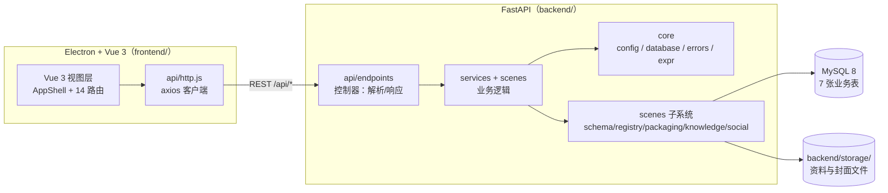

# EchoTalk 2.0 技术文档

> 覆盖 2026-09-27 的三次提交：`0c9cac7`（2.0 重构基础）、`ff21f72`（场景包模块）、`4e81702`（场景页打磨 v1.6）。
>
> 配套文档：[开发文档](开发文档.md)（环境搭建、工作流、排错）；产品与界面设计见 `EchoTalk-2.0-Design-Package/`。
>
> 版本：2.0.0 · 更新：2026-09-28

---

## 1. 版本范围

| 提交 | 内容 | 规模 |
|---|---|---|
| `0c9cac7` | EchoTalk 2.0 重构：账户后端（注册/登录/退出/会话）、MySQL 数据层、桌面壳规范化（AppShell + Electron）、云端/本地架构基础；删除 1.0 遗留模块（旧代码归档在 `backend-1.0/`、`frontend-1.0/`） | 137 文件，+10605 / -2002 |
| `ff21f72` | 场景包模块：v2 包格式（创建/导入/导出）、内置种子、知识资料分块、发布与社区统计、前端场景探索页与四步创建向导、37 项冒烟脚本 | 后端 ~2400 行 + 前端 ~2300 行 |
| `4e81702` | 场景页体验打磨（v1.6）：详情底栏固定、ID 校验友好化、`package_json` 存完整 dump 的架构修复、路由复用修复 | 6 文件 |

## 2. 总体架构



分层原则（当前代码库的实际组织）：

- **控制器层** `api/endpoints/*`：只解析请求、调用服务、格式化响应，不含业务逻辑；路由静态路径先于 `/{scene_id}` 注册。
- **服务层** `services/*` + `scenes/*`：全部业务规则（权限、校验、编排、统计），只接收 SQLAlchemy 会话与业务参数，不接触 HTTP 类型。
- **基础层** `core/*`：配置、数据库、错误体系、表达式求值器、时间工具；被所有上层依赖。

## 3. 技术栈

| 层 | 技术 | 版本约束 |
|---|---|---|
| 后端框架 | FastAPI + Pydantic v2 | fastapi ≥0.115 <1.0 |
| ORM / 数据库 | SQLAlchemy 2.x + PyMySQL，MySQL 8（utf8mb4） | sqlalchemy ≥2.0 <3.0 |
| 包管理 | uv（`pyproject.toml` + `uv.lock` 锁定，Python 3.12） | requires-python >=3.12,<3.13 |
| 场景包解析 | PyYAML + zipfile | pyyaml ≥6.0 |
| 前端框架 | Vue 3（Composition API）+ Vue Router 4（hash 模式） | vue ^3.4 |
| HTTP 客户端 | axios（统一拦截器） | axios ^1.6 |
| 构建 | Vite 5 | vite ^5.2 |
| 桌面壳 | Electron 30 + electron-builder | electron ^30 |

无状态机、无重库依赖：会话状态用响应式模块（`src/auth/session.js`），列表筛选/排序/分页全部用 `computed`。

## 4. 后端设计

### 4.1 应用装配与请求生命周期

`app/main.py` 是唯一装配点：

1. `register_exception_handlers(app)`：注册全局异常处理。
2. `@app.on_event("startup")` → `scenes/registry.sync_seeds()`：内置场景包种子同步（表未初始化时仅告警不阻断）。
3. `@app.middleware("http")`：每请求分配/透传 `X-Request-ID`（12 位 hex），记录结构化 JSON 访问日志（方法/路径/状态/耗时 ms），响应头回传请求 ID。
4. CORS：显式来源白名单（`ECHOTALK_CORS_ORIGINS`，桌面 `file://` 来源为 `null`，需列入）；方法含 PUT/PATCH/DELETE；`expose_headers` 放行 `Content-Disposition`（导出下载需要）。
5. 路由：`/api/auth/*`、`/api/scenes/*` 统一挂 `/api` 前缀。
6. 探针：`GET /api/health`（存活，不查依赖）、`GET /api/ready`（`SELECT 1` 验库，失败 503）。

### 4.2 配置与快速失败

`core/config.py` 优先级：真实环境变量 > `backend/.env` > 默认值。**`ECHOTALK_DB_PASSWORD` 为空时直接 `RuntimeError` 终止启动**（给出可操作提示），避免连接期的晦涩报错。连接串用 `URL.create()` 组装，密码特殊字符无需手工转义。

| 变量 | 默认 | 说明 |
|---|---|---|
| `ECHOTALK_DB_HOST / PORT / NAME / USER / PASSWORD` | 127.0.0.1 / 3307 / echotalk / echotalk_app / 必填 | MySQL 连接 |
| `ECHOTALK_API_HOST / API_PORT` | 127.0.0.1 / 8000 | 监听地址 |
| `ECHOTALK_CORS_ORIGINS` | `http://localhost:5173,http://127.0.0.1:5173` | 逗号分隔来源白名单 |

连接池：`pool_pre_ping=True` + `pool_recycle=1800`，防 MySQL 空闲断连。会话为请求级事务会话（`get_db` 依赖，finally 关闭）。

### 4.3 统一错误体系

业务代码只抛 `AppError` 子类（`core/errors.py`）；全局处理器转换为规范化响应：

```json
{ "error": { "code": "SCENE_ID_CONFLICT", "message": "…", "details": [{"field": "…", "message": "…"}] } }
```

- `details` 为可选字段级错误列表（场景包校验用），前端表单逐项标注。
- 未预期异常：服务端记录堆栈日志，对外只返回 `500 internal_error` 固定文案。
- 错误码约定（附录于场景包方案，全部已实现）：

| 错误码 | HTTP | 场景 |
|---|---|---|
| `unauthorized` | 401 | 未登录 / 会话失效 |
| `conflict` | 409 | 用户名已被注册 |
| `SCENE_NOT_FOUND` | 404 | 场景不存在（他人私有场景同样按 404 返回，不泄露存在性） |
| `SCENE_ID_CONFLICT` | 409 | 创建/导入 ID 冲突（提示 overwrite / rename） |
| `SCENE_BUILTIN_READONLY` | 409 | 修改/删除/发布内置场景 |
| `SCENE_INVALID_PACKAGE` | 422 | 包校验失败，details 字段级 |
| `SCENE_INVALID_EXPRESSION` | 422 | 表达式解析失败 |
| `SCENE_UNSUPPORTED_FILE` | 400 | 资料/封面类型不支持或超限 |
| `SCENE_PACKAGE_INCOMPATIBLE` | 422 | `min_app` 高于当前应用 |
| `SCENE_ID_IMMUTABLE` | 400 | 编辑时试图修改场景 ID |
| `SCENE_FORBIDDEN` | 403 | 操作他人场景 |

### 4.4 认证与会话设计

| 环节 | 实现 | 安全考量 |
|---|---|---|
| 密码存储 | PBKDF2-SHA256，310,000 迭代，每账户 16 字节随机盐，存储 `盐$摘要` | 不存明文；抗暴力破解 |
| 登录校验 | `secrets.compare_digest` 恒定时间比较；对不存在用户名执行同等成本哈希 | 防时序攻击、防用户名枚举 |
| 会话签发 | `secrets.token_urlsafe(32)` 原始令牌仅返回一次；库中只存 SHA-256 摘要 | 数据库泄露也无法伪造令牌 |
| 会话有效期 | 30 天（`auth_sessions.expires_at`）；退出写 `revoked_at` | 多设备独立会话，互不影响 |
| 请求鉴权 | `api/deps.py`：`get_current_session`（Bearer → 摘要 → 查有效未撤销会话）→ `get_current_user`（身份只来自令牌，不接受客户端传 ID）；`get_optional_user`（游客返回 None 不报 401） | 场景列表/详情/封面支持游客只读 |
| 输入校验 | Pydantic：用户名 3–50、密码 8–128 | 边界处校验 |

并发注册兜底：前置查询 + 唯一索引双保险，`IntegrityError` 捕获后转 `409 conflict`。

### 4.5 数据模型（7 张表）

```
users ──1:N── auth_sessions
  │
  └─1:N── scenes（author_id，builtin 为 NULL）──1:N── documents ──1:N── chunks
                │            │
                │            └──1:1── scene_stats（likes/downloads/favorites 计数）
                │            └──1:N── scene_user_stats（scene_id+user_id 唯一，一人一票）
```

| 表 | 关键列 | 说明 |
|---|---|---|
| `users` | username(唯一)、password_hash | 账户 |
| `auth_sessions` | token_hash(唯一)、expires_at、revoked_at | 服务端会话 |
| `scenes` | **id=meta.id**（字符串主键）、package_json(完整包)、source(builtin/custom/imported)、status(private/published)、difficulty、cover_path、greeting_text、domain_keywords | 场景包；标量列为查询/展示冗余，`package_json` 是唯一事实来源 |
| `documents` | scene_id(CASCADE)、filename、chunk_count、visibility(user/ai_only) | 资料元数据；源文件在 storage |
| `chunks` | document_id(CASCADE)、scene_id(冗余索引)、section、visibility、ordinal、text | 解析分块；向量索引为运行时产物（阶段 3） |
| `scene_stats` | scene_id(主键)、likes、downloads、favorites | 聚合计数，惰性创建 |
| `scene_user_stats` | (scene_id,user_id) 唯一约束、liked、favorited | 用户互动态，一人一票 |

两个关键决策：

- **`package_json` 存校验后模型的完整 dump**（v1.6 修复）：此前存原始请求 dict，Pydantic 默认值（category/mode/version）不落库，导致编辑回显下拉为空、导出包不完整；现改为 `model_dump()` 完整落库，读写两端结构一致。
- **难度五级英文枚举** `entry/easy/normal/hard/expert`（前后端契约）：校验器强制小写；种子同步时执行幂等迁移 `_migrate_difficulties`（历史 CEFR 按首字母 A→easy / B→normal / C→hard，中文三档直接映射，未知归 normal），冗余列与 `package_json.meta.difficulty` 同步刷新。

### 4.6 场景包子系统（`app/scenes/`）

#### schema.py — ScenePackage 声明模型

场景包 v2 = `meta / roles(1-4) / prompt / objectives(≤8) / state / tools / coordination / stages(≤8) / finish / knowledge / evaluation / guardrails / avatar`。三个入口（创建、编辑、导入）共用同一模型校验。

跨字段校验（`model_validator`）：

- 角色 id 不重复；`coordination.order` 只引用已存在角色。
- `tools.allowed` ⊆ 工具注册表（9 个：`search_knowledge / lookup_word / get_learning_profile / calculate_order / modify_order / update_scene_state / get_hint / add_review_task / next_interview_stage`）；`tools.config` 键 ⊆ `allowed`。
- `prompt.system / greeting` 的 `{占位符}` 必须可解析：`{param}` 或 `{roles.<id>.<字段>}`（经 `expr.extract_placeholders` 提取）。
- 表达式 dry-run：`objectives[].check`、`stages[].exit_when`、`finish.when` 中引用的 state 根键必须包内声明。

校验失败还原：Pydantic 会把 `model_validator` 抛出的 `SceneValidationError` 包进 `ValidationError.errors()[i]["ctx"]["error"]`，`registry.validate()` 负责解包为字段级 details，并剥掉 `"Value error, "` 前缀（v1.6）。

#### core/expr.py — 白名单表达式子语言

```text
文法：and / or / not + 比较（== != >= <= > < in）
引用：state.<路径>（支持 . 与 [n]，根必须名为 state）
     stage / stage_turns / turn_count（运行时保留键）
函数：tool_called('名') / state_changed('路径') / goals_done()
字面量：true / false / null / 数字 / '字符串'
```

- `parse()`：Python `ast` 解析 + 节点类型白名单，禁止属性访问、任意调用、算术与关键字参数；函数参数必须是字符串字面量。
- `dry_run(expr, declared_keys)`：校验期检查引用的 state 根键都在包内声明（保留键除外）。
- `evaluate(expr, ctx)`：运行时求值（每轮工具执行后调用）。
- 公开接口：`parse / dry_run / evaluate / extract_placeholders`。

#### registry.py — 种子同步、缓存与行/包互转

- **内置场景入库**（source=builtin）与自定义同构；启动与 `init_db.py` 各同步一次，按 `meta.version` 判断是否刷新。
- **缓存**：进程内 `dict[scene_id → ScenePackage]`；所有写操作调用 `invalidate_cache()`（可单键），get 回源 DB 并再校验一次（防脏数据，脏数据抛 422 而非中断服务）。
- `summary()`：场景卡摘要（分类/难度/标签/目标数/资料数/角色/封面/统计互动态），校验失败时降级用行冗余列渲染。
- 内置场景只读：编辑/删除返回 `409 SCENE_BUILTIN_READONLY`，替代路径是「复制为自定义」。

#### packaging.py — v2 ZIP 导入导出

```text
echotalk_scene_{id}.zip
├── manifest.json   # {format:"echotalk-scene", version:2, scene_id, min_app, files, checksums(SHA-256)}
├── scene.yaml      # 完整包声明（唯一必需文件）
└── knowledge/      # 资料源文件（user 与 ai_only 都导出；可见性是作者教学设计）
```

- **导出**：从 `package_json` dump 回 YAML（保持顺序），逐文件写校验和；不含任何向量索引或数据库 dump。
- **导入**：`parse_zip()` 全量校验 → 冲突处理。旧 1.0 包（含 `scene_config.json` 或 `*.index`）**直接拒绝**并给出可解释原因。冲突策略：`resolve` 缺省抛 409；`overwrite` 只允许覆盖自己的场景（source 改为 imported）；`rename` 自动改名 `{id}_2、{id}_3…`；**内置 ID 不可覆盖**，只能 rename。`min_app` 版本兼容检查在包与 manifest 双通道读取。
- 资料入库按包内 `knowledge.files[].visibility` 决定文件级可见性；单个资料失败记录日志跳过，不阻断导入。

#### knowledge.py — 源文件、分块与封面

- 存储：`backend/storage/scenes/{scene_id}/knowledge/`（按场景隔离，天然限定检索/导出范围）与 `backend/storage/scenes/{scene_id}/cover.*`。
- 资料：`.md/.markdown/.txt/.pdf`，单文件 ≤ 10 MB，同名覆盖即更新。
- 分块：Markdown 按标题分节（无标题整文件一节）；目标块长 700 字符、上限 1100，超长按空行段落二次切分；`visibility` 支持文件级与分节级（`user` 学习者可见 / `ai_only` 仅检索）。
- 封面：`.jpg/.jpeg/.png/.webp` ≤ 5 MB；换格式时清理旧封面；`GET /{id}/cover` 免登录（卡片 `` 直链）。

#### social.py — 发布与社区统计

- 可见性矩阵：builtin 全员；本人全部；他人仅 `status=published`。
- 发布/取消发布轻量：改 `status` + 首次记录 `published_at`；取消发布统计保留。
- 点赞/收藏：`scene_user_stats` 唯一约束去重，一人一票，切换返回最新计数与状态。
- 下载量：**非作者**导出时 +1（作者导出不计）。
- `stats_map()`：列表页一次批量查询聚合计数与当前用户互动态，避免逐行 N+1。

### 4.7 接口契约总表

鉴权列：🔒 必须登录 / 🔓 游客可访问（携带有效令牌则增强返回）。

| 方法与路径 | 鉴权 | 说明 |
|---|---|---|
| `POST /api/auth/register` | 🔓 | 201，返回 `{access_token, user}` |
| `POST /api/auth/login` | 🔓 | 返回 `{access_token, user}` |
| `POST /api/auth/logout` | 🔒 | 204，仅撤销当前令牌 |
| `GET /api/auth/me` | 🔒 | 当前用户 |
| `GET /api/health` / `GET /api/ready` | 🔓 | 存活 / 就绪（验库） |
| `GET /api/scenes` | 🔓 | 可见场景列表 + 统计（游客仅 builtin） |
| `GET /api/scenes/templates` | 🔓 | 内置模板摘要 |
| `POST /api/scenes/validate` | 🔓 | 干跑校验，422 返回字段级 details |
| `POST /api/scenes/import?resolve=overwrite\|rename` | 🔒 | 导入 v2 ZIP；返回 `{scene, action: created/overwritten/renamed}` |
| `POST /api/scenes/from-template` | 🔒 | `{template_id, new_id?}` 复制内置为自定义 |
| `POST /api/scenes` | 🔒 | 创建（body=完整包），默认私有 |
| `GET /api/scenes/{id}` | 🔓 | 详情：摘要 + 完整包 + 资料元数据 + 统计（ai_only 分节内容不下发） |
| `PUT /api/scenes/{id}` | 🔒 | 更新（builtin 409；ID 不可变） |
| `POST /api/scenes/{id}/duplicate` | 🔒 | 复制为自定义私有副本（含资料与封面） |
| `DELETE /api/scenes/{id}` | 🔒 | 删除（源文件、documents/chunks、封面一并清除） |
| `GET /api/scenes/{id}/export` | 🔓 | 导出 ZIP；非作者计入下载量 |
| `POST /api/scenes/{id}/cover` | 🔒 | 上传封面（仅作者） |
| `GET /api/scenes/{id}/cover` | 🔓 | 封面图直链（未设置 404 `SCENE_NO_COVER`） |
| `DELETE /api/scenes/{id}/cover` | 🔒 | 移除封面 |
| `POST /api/scenes/{id}/publish` / `unpublish` | 🔒 | 发布 / 撤回（builtin 409） |
| `POST /api/scenes/{id}/like` / `favorite` | 🔒 | 点赞 / 收藏切换（一人一票） |
| `POST /api/scenes/{id}/knowledge?visibility=user\|ai_only` | 🔒 | 上传资料（解析→分块→入库） |
| `GET /api/scenes/{id}/knowledge` | 🔓 | 学习者可见分节（对话页参考面板） |
| `GET /api/scenes/{id}/knowledge/sections` | 🔓 | 全分节概览（含 ai_only） |
| `PATCH /api/scenes/{id}/knowledge/sections/{name}` | 🔒 | 修改分节可见性 |
| `DELETE /api/scenes/{id}/knowledge/{document_id}` | 🔒 | 删除单个资料（1.0 只能全清） |

## 5. 前端设计

### 5.1 应用结构与路由

```
frontend/src/
  main.js / App.vue          # 入口；App.vue 仅 router-view，布局由路由结构决定
  router/index.js            # hash 模式（兼容 Electron file://）
  layouts/AppShell.vue       # 应用壳：侧边栏分组导航 + 标题栏 + 账户浮层
  auth/session.js            # 响应式会话：token 持久化 localStorage，user 由 /me 确认
  api/http.js, auth.js, scenes.js
  views/  Login / Workspace / Scenes / SceneEditor / ModulePlaceholder
  components/AppIcon.vue     # 图标组件
  assets/styles.css          # 设计令牌（#6265E8 主色等）与共享样式
```

路由策略：登录页在壳外全屏；其余 14 个路由都是 AppShell 子路由，未实装模块统一指向 `ModulePlaceholder`（标题/描述写在 `meta`，诚实标注规划中）。路由守卫：游客放行全部页面（可浏览场景），已登录访问 `/login` 跳回工作区；刷新后有令牌无用户时调 `/me` 恢复身份，失败清会话跳登录。

AppShell 关键点：路由视图绑定 `:key="route.fullPath"`（v1.6 修复：`scenes/create` 与 `scenes/:id/edit` 复用同一组件时不重挂载导致表单为空）；侧边栏折叠 + `Cmd/Ctrl+B`，偏好存 localStorage。

### 5.2 API 客户端（api/http.js）

- **Base URL 解析**：`window.electronAPI?.backendBaseUrl` → `VITE_API_BASE_URL` → `http://127.0.0.1:8000`；统一走 `/api` 前缀；15s 超时（导入/导出/资料上传 60s、封面 30s 单独放宽）。
- **令牌**：请求拦截器自动附加 `Authorization: Bearer`；401 时清空本地登录态（路由守卫随后跳登录页）。
- **错误规范化**：网络失败 → 离线提示；`body.error.message` → 可读文案（无则按状态码兜底）；同时挂载 `code`（机器可读）与 `details`（字段级）供调用方程序化处理（如导入冲突弹窗）。
- **重试策略**：仅幂等 GET，网络错误或 5xx，最多 3 次，递增退避 0.5s/1s/1.5s；4xx 一律不重试。

### 5.3 场景探索页（views/Scenes.vue）

- 来源筛选（全部/内置/我的/社区/收藏）+ 分类 chips + 关键字搜索 + 排序 + 常驻分页栏（PAGE_SIZE=9）。
- 排序：热度 = `likes×3 + favorites×2 + downloads`，同分按创建时间新者优先；另有最新创建/下载最多/收藏最多。
- 详情弹窗：底部操作栏移出滚动容器固定贴底（v1.6）；封面保留在详情与创建向导，卡片不再显示（v1.6 节奏统一）。
- 导入冲突弹窗：后端 409 后提供覆盖/改名选择，携带 `resolve` 重发。
- 视觉约定：难度五级彩色 chip（前端映射中文与配色）、点赞激活红、收藏激活黄、作者头像色板。

### 5.4 场景编辑器（views/SceneEditor.vue，约 1300 行）

四步向导（基本信息 → 角色与提示词 → 目标与状态 → 规则与完成）：

- **引导式对话指引**：普通模式由表单自动拼装 System Prompt（`assembleSimplePrompt`，含角色、语气、规则与工具说明），可切换高级模式直接编辑原文，无损互转。
- **变量插入**：可用的 `{param}` 与 `{roles.*}` 以 chips 形式点击插入光标处（`variableChips` + `insertTo`）。
- **state 编辑**：键值行编辑器 ↔ JSON 高级模式互转（`stateToRows / stateFromRows`）；声明的键实时反馈给目标判定与结束条件构建器。
- **条件构建器**：目标判定与结束时机提供四选一（不判定 / 状态条件 / 工具调用 / 全部目标完成），状态条件按 `state.<key> <op> <value>` 正则解析回填（`STATE_COND_RE`）。
- **场景 ID**：编辑模式禁用输入（创建后不可改，与后端 `SCENE_ID_IMMUTABLE` 契约一致）；保存前置校验失败时给「人话」文案并跳回第 1 步。
- **封面**：创建模式暂存 `pendingCover`，保存成功后补传；编辑模式直传并 `bust` 参数强制刷新缓存。
- **模板**：向导第 1 步可从内置模板一键应用后修改。

### 5.5 桌面壳（Electron）

- 主窗口 `titleBarStyle: 'hidden'` + 应用内标题栏：macOS 红绿灯 `trafficLightPosition {x:16, y:18}`（中线 y=24 与标题栏 48px 中线对齐），Windows/Linux 用 `titleBarOverlay` 原生按钮。
- 安全基线：`contextIsolation: true`、`nodeIntegration: false`、preload 最小暴露（`getAppVersion`、`platform`）；应用内禁止新开窗口，外部 https 交给系统浏览器。
- 加载：开发 `http://127.0.0.1:5173`（与 Vite `strictPort` 约定一致），打包 `dist/index.html`（`base: './'` 相对路径）。
- CSP（`index.html` + Vite 插件 `echotalk-api-csp`）：占位符 `__ECHOTALK_API_ORIGIN__ / __ECHOTALK_DEV_ORIGINS__ / __ECHOTALK_DEV_INLINE__ / __ECHOTALK_DEV_EVAL__` 按构建配置替换；`img-src` 放行 `data: blob:` 与 API 源（跨域封面）。正式构建强制 `VITE_API_BASE_URL` 为 HTTPS（缺失或 http 直接构建失败）。

## 6. 安全设计清单

| 项 | 实现 |
|---|---|
| 密码 | PBKDF2-SHA256（310k 迭代）+ 每账户盐；不存明文 |
| 令牌 | 原始令牌仅返回一次，库中只存 SHA-256 摘要；30 天有效；退出即撤销 |
| 时序 | 恒定时间比较 + 未知用户同成本校验 |
| 输入 | 全部请求经 Pydantic 边界校验；场景包经 ScenePackage 全量校验 + 表达式白名单 dry-run |
| 包导入 | 无代码执行；SHA-256 校验和；`min_app` 兼容检查；1.0 旧包拒绝；冲突显式处理 |
| 文件 | 类型白名单 + 大小上限（资料 10MB / 封面 5MB）；按场景隔离存储 |
| CORS | 显式来源白名单；Electron file:// 需列入 `null`；生产禁止通配符 |
| CSP | img/connect 只放行配置的 API 源 |
| 日志 | 结构化 + 请求 ID；不记录密码/令牌；未预期异常不外泄堆栈 |
| 权限 | 身份只来自令牌；builtin 只读；他人私有场景按 404 返回（不泄露存在性）；覆盖他人场景 403 |

## 7. 关键设计决策（ADR）

| # | 决策 | 理由 |
|---|---|---|
| D1 | MySQL 而非 SQLite | 2.0 起云端部署与多设备目标；连接串用 `URL.create` 免转义 |
| D2 | 内置场景入库（builtin），只读 + 可复制 | 与自定义场景同构，统一查询与接口；避免 1.0「插件优先 + DB 补充」的双轨规则 |
| D3 | `package_json` 存校验后完整 dump | 默认值显式落库，编辑回显/导出 ZIP 不缺字段（v1.6 架构修复） |
| D4 | 场景包不执行代码，工具只做白名单引用 | 杜绝任意执行面；校验期 dry-run + 运行时白名单求值双保险 |
| D5 | v2 ZIP 不携带向量索引 | 索引与 embedding 模型绑定、跨环境不可靠；导入用源文件重建（阶段 3 Hybrid RAG） |
| D6 | 1.0 旧包直接拒绝而非兼容转换 | 旧包只有 chunks 无完整源语义，转换链路成本高于收益；内置四场景已覆盖旧内容 |
| D7 | 难度五级英文枚举 + 启动迁移 | 前后端契约用英文枚举存储，中文标签由前端映射；历史值幂等归一 |
| D8 | 统计惰性建行 + 批量查询 | builtin 场景首次互动才建 `scene_stats`；列表一次查询防 N+1 |
| D9 | 表达式引用的 state 根键必须包内声明 | 编辑期就能发现拼写错误；运行时保留键（stage 等）与包声明键空间隔离 |

## 8. 已知限制与后续规划

- 场景包导入导出、资料管理已闭环；**向量检索（Hybrid RAG）、会话与 LangGraph、语音链路**尚未实现（chunks 已入库，为阶段 3 预留）。
- 认证为长期 Bearer 令牌（30 天），未做短时效 + 刷新令牌轮换；个人作品阶段可接受，多用户部署前建议补齐。
- 封面/资料为本地磁盘存储，云端部署需替换为对象存储（storage 调用集中在 `scenes/knowledge.py`，替换点单一）。
- 知识可见性 `ai_only` 分节内容目前仍随详情接口的 `documents` 元数据暴露文件名（内容不下发）；管理界面做权限分级时可再收紧。
- 后台任务（问候语 TTS 预合成、索引重建）尚未接入，`greeting_audio_path` 字段已预留。
